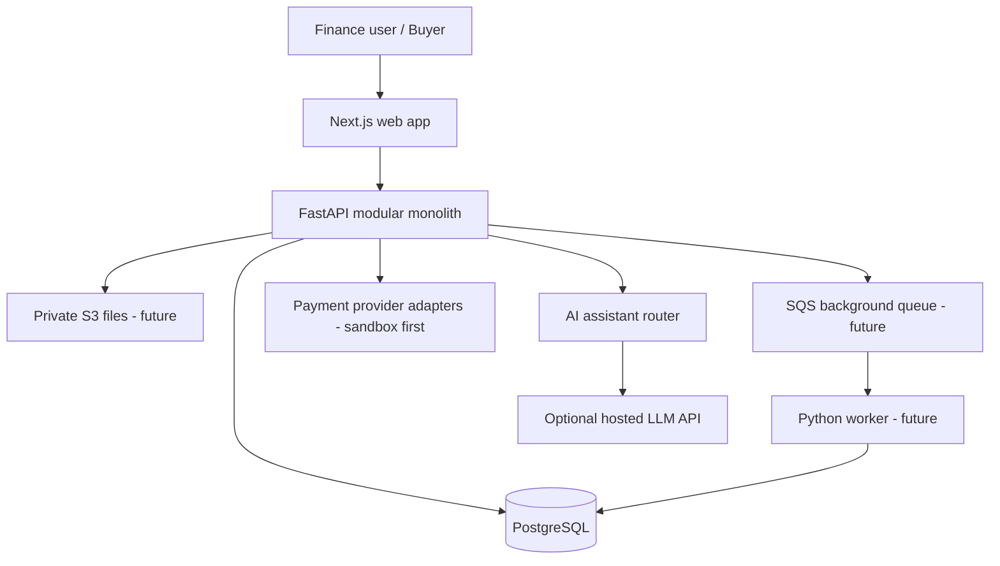

# Architecture overview



## Backend modules currently represented
- Authentication: demo user login and JWT issuance.
- Organization scoping: records are filtered by the authenticated user's organization ID.
- Receivables: customers and invoices.
- Payments: manual/demo payment records and invoice balance updates.
- Accounting: balanced journal entries for invoice issuance and receipts.
- Reconciliation: CSV imports, conservative match suggestions, human confirmation.
- Governance: basic audit events.
- AI assistant: authenticated, organization-scoped read-only finance context; optional LLM provider call; demo fallback without an API key.
- Frontend components are separated by domain: dashboard, invoices, reconciliation, ledger, audit, operations, authentication, modals, and assistant.

## Important current limitations
- This is a modular-monolith starter, not a certified accounting product.
- Database tables are currently created at startup for ease of learning. Use reviewed migrations in any production deployment.
- The demo JWT secret fallback is not suitable for production.
- No real payment provider or live banking integration is included.
- The CSV reconciliation suggestion logic is intentionally simple and should not auto-post ledger entries.
- Audit events are ordinary database rows, not tamper-proof records.
- Full enterprise controls, MFA, refresh-token/session revocation, rate limiting, and complete test coverage remain future work.
- The AI assistant is a portfolio feature, not a production financial advisor. Provider access, privacy, retention, prompt-injection testing, usage limits, and evaluation must be reviewed before any public or sensitive-data deployment.
```

## AI assistant data handling

When `OPENAI_API_KEY` is configured, the API sends the current authenticated organization's invoice numbers, customer names, descriptions, due dates, statuses, and financial amounts to the configured OpenAI chat-completions endpoint for answer generation. Do not enable this with real customer data until privacy, contractual, retention, and compliance requirements have been reviewed. The key remains on the backend and is never exposed to the browser. With no key, the assistant uses a limited deterministic fallback.
